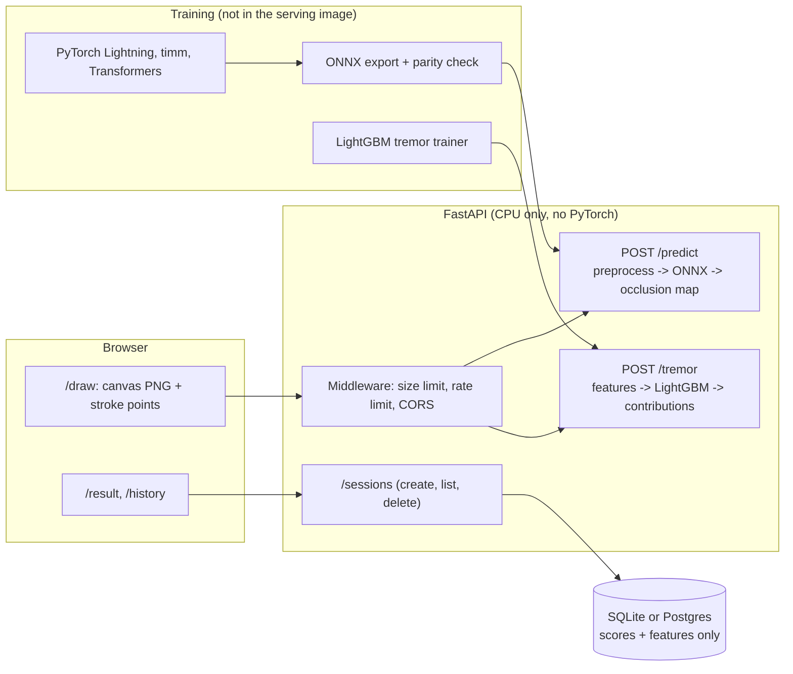
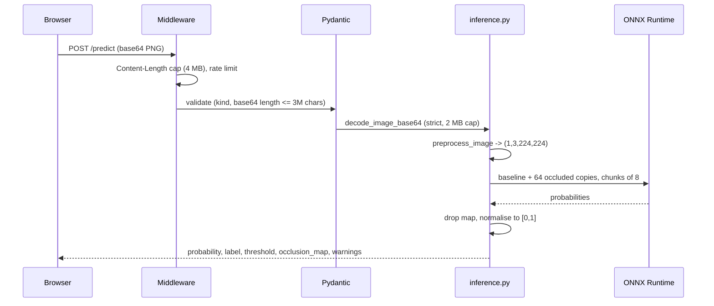

# Presentation: Parkinson Screen

## 1. One-line pitch

> "A screening-aid pipeline that turns a hand-drawn spiral into a calibrated-by-design, explainable result, served from a 512 MB CPU container, with the same preprocessing code in training and serving so what we validated is what we deploy."

(Say "screening aid", never "diagnosis" or "detects Parkinson's". The repo's own checklist asks for this.)

## 2. Slide-by-slide

### Slide 1: Title
- Parkinson's screening aid from spiral and wave drawings
- Your name, course, date
- Disclaimer line on the slide: *Screening aid, not a diagnosis. Not clinically validated.*

**Notes:** Put the disclaimer on the first slide, not the last. It signals maturity and pre-empts the obvious objection.

### Slide 2: Problem and scope
- Spiral and wave drawing tests are a standard clinical bedside tool; tremor and micrographia show up in them
- Goal: an accessible, explainable screening aid, not a diagnostic
- Two independent signals: the *picture* (CNN) and the *motion* (tremor kinematics)
- Data: HandPD and NewHandPD, 1,264 images, 158 subjects (105 Parkinson's, 53 healthy), 8 drawings per subject

**Notes:** Mention early that the two signals are independent on purpose: the image model sees a finished drawing, the tremor pipeline sees timing. That is why the backend has two separate endpoints.

### Slide 3: System at a glance



**Notes:** Walk left to right. The key sentence: "Everything on the right-hand side of the browser is a CPU container; everything in the Offline box never ships."

### Slide 4: Two runtimes, one contract
- Offline: PyTorch Lightning, five backbones, ablations, Grad-CAM, MLflow registry
- Online: `onnxruntime` + `lightgbm` + FastAPI. No torch, no shap, no matplotlib
- Separate dependency files: `requirements-train.txt` vs `backend/requirements.txt`
- Why: target is Render's free tier, 512 MB RAM
- CI has a dedicated `backend-only` job that installs *only* the backend requirements and runs the backend tests, which proves the lean-dependency claim on every push

**Notes:** This is your strongest "engineering judgement" slide. The constraint (512 MB) drove the design: ONNX export, LightGBM's built-in `pred_contrib` instead of the `shap` package, and the occlusion map instead of Grad-CAM in production.

### Slide 5: One preprocessing implementation (train/serve skew)
- `common/preprocess.py` is the single source of truth: grayscale, crop to content with padding, aspect-preserving resize onto white, scale to [0, 1], replicate to 3 channels
- Training reads image paths through it; the backend reads canvas PNG bytes through it
- A test asserts both paths produce a **bit-identical tensor** (`np.array_equal`)
- The Dockerfile copies that one file into the image rather than depending on the training package

**Notes:** Train/serve skew is the most common silent failure in deployed ML. Say that a canvas PNG and a scan go through the same function and a test proves it. Be honest that this removes *code* skew, not *domain* skew (scan vs canvas look different).

### Slide 6: API design
| Endpoint | Purpose |
|---|---|
| `GET /api/v1/health` | Model status, always 200, reports `ok` or `unavailable` |
| `POST /api/v1/predict` | Base64 PNG/JPEG -> probability, label, occlusion map |
| `POST /api/v1/tremor` | Stroke points -> 11 to 13 features, score, top-5 contributions |
| `POST /api/v1/sessions` | Save a result (features and scores only) |
| `GET /api/v1/sessions?device_id=` | List own history |
| `DELETE /api/v1/sessions?device_id=` | Delete all own data |

- Versioned prefix, typed Pydantic request and response models, auto OpenAPI at `/docs`
- **One error envelope** for validation, HTTP and unexpected errors: `{code, detail, disclaimer}`
- Every response model carries the disclaimer string (a `Disclaimed` base class)
- Three-way label: `lower_concern`, `higher_concern`, `uncertain` (within ±0.05 of the threshold)

**Notes:** The "uncertain" band is a product decision: the system is allowed to say "I do not know". Point out that no label says "Parkinson's" or "healthy".

### Slide 7: Lifecycle of a `/predict` request



**Notes:** Mention that handlers are plain `def`, not `async def`, because ONNX and LightGBM calls block; FastAPI runs them in its thread pool and the event loop stays free (this is a documented decision in `docs/DECISIONS.md`).

### Slide 8: Explainability designed for serving
- Production explanation is an **occlusion map**: cover each cell of an 8x8 grid with white, measure the drop in probability
- Cost: 1 baseline + 64 forward passes = 65. Cheap in code, expensive in memory if batched naively
- Measured by the author: a single batch of 65 peaked near **2 GB** of activations, far past 512 MB
- Fix: run in chunks of 8, cap total passes with `effective_grid`, ONNX session with arena and mem-pattern disabled
- The UI text says "where the model looked, not why it is right". A test asserts the description never claims Grad-CAM
- Grad-CAM exists offline only, with a deletion-curve faithfulness check

**Notes:** This is a good story: a real production constraint found by measuring, then a code-level fix with tests (`test_chunked_inference_matches_one_image_at_a_time`, `test_effective_grid_respects_the_pass_cap`).

### Slide 9: Tremor analysis pipeline
- Input: `(x, y, t_ms, pressure, pointer_type, pen_lift)` per point
- Steps: sort and de-duplicate time, resample to 100 Hz, Savitzky-Golay smoothing, velocity, **2 Hz high-pass (zero-phase) to remove voluntary movement**, Welch spectrum
- Key design insight: Welch on the *x* and *y* velocity components and **sum them**, rather than on speed. Speed is a magnitude of two rotating vectors, which creates intermodulation sidebands and smears the tremor peak
- Features: tremor-band ratio (4 to 12 Hz), peak frequency, spectral entropy, jerk (normalised), pause ratio, pen lifts, spiral deviation (Archimedean fit), pressure (pen only)
- Never raises on bad input: returns warnings (too short, too sparse, mouse noise) instead
- **Verified by me:** injected frequencies from 3 to 12 Hz were recovered to within **0.28 Hz** (spec: 0.5 Hz), with and without noise

**Notes:** "No labelled recordings with diagnoses exist for this task, so we validated the pipeline the standard way for signal processing: inject a known tremor and check recovery."

### Slide 10: Interpretable score with exact attributions
- LightGBM on 13 features, trained on **simulated** spirals (600 samples, 150 rounds, 8 leaves)
- Contributions come from `booster.predict(pred_contrib=True)`: exact TreeSHAP from the library, no `shap` package needed
- A test asserts the contributions sum to the raw score (residual in the model card: 3.7e-14)
- API returns the top 5 features with plain-language explanations
- Provenance string and `trained_on: "synthetic"` are returned on **every** response and shown in the UI

**Notes:** Say clearly: this model demonstrates that the features respond to tremor and that explanations work end to end. It is not a clinical model. The 0.998 cross-validated AUC is a property of the simulator (classes separable by construction), and the model card says so.

### Slide 11: Data handling and privacy
- Sessions table stores **scores and features only**: no images, no raw strokes (a test asserts the column set)
- Pseudonymous `device_id` (random UUID in the browser), validated by regex `^[A-Za-z0-9_-]{8,64}$`
- Per-device cap of 500 rows (oldest trimmed in the same transaction as the insert)
- User can delete everything: `DELETE /sessions`
- `postgres://` URLs from Render are rewritten to `postgresql+psycopg://`; SQLite and Postgres share one code path

**Notes:** Do not claim GDPR or HIPAA compliance; claim "data minimisation by design".

### Slide 12: Defensive engineering in the backend
- Input bounds in Pydantic: coordinate range, timestamp range, pressure in [0, 1], finite-number validators (no NaN/Inf), feature dict capped at 64 keys
- Request size cap (413), per-client sliding-window rate limit (429), strict CORS allow-list, no credentials
- Graceful degradation: missing model file does not crash the app; `/health` reports it and `/predict` answers 503; `/tremor` still returns features without the model
- Non-root container user, multi-stage build, pinned dependencies, HEALTHCHECK
- Structured error handler: unexpected exceptions are logged server-side and return a generic message

**Notes:** Be ready to say "these are demo-grade protections; CODE_REVIEW.md lists what I would harden next". Showing you know the gaps is better than being asked.

### Slide 13: Testing, CI and deployment
- 261 Python test functions across 20 files (36 for the backend), plus Vitest tests for the frontend
- Backend tests use `TestClient` with in-memory SQLite and cover: 503 paths, size and rate limits, CORS, label margin, determinism, chunk-vs-single parity
- ONNX export has a **parity check** against PyTorch: max abs difference 6e-8 (contract 1e-4)
- CI: lint (ruff), types (mypy), tests, backend-only job, frontend job, Docker build
- Deploy: `docker compose up` (frontend, backend, Postgres with health-gated start) or Render blueprint
- Honest status: CI and the Docker image have not been run yet (see `HANDOFF.md`)

### Slide 14: Honest limitations
- Image model is a development placeholder: no real accuracy numbers exist yet
- Tremor model trained on simulated data only
- Domain shift: trained on paper scans, used on canvas drawings; untested on real canvas data
- 158 subjects: wide confidence intervals; many model differences will be within noise
- Mouse input is noisy; not clinically validated; not a medical device
- Known engineering gaps found in review (see CODE_REVIEW.md): memory cap on large images, tremor score gating, chunked-body limit

### Slide 15: Demo (see section 4) and Slide 16: Questions

## 3. Numbers you can quote (all checked)

| Fact | Value | How I know |
|---|---|---|
| Images / subjects | 1,264 / 158 (105 PD, 53 healthy) | counted from `data/folds.csv` |
| Images per subject | 8 (4 spiral + 4 wave) | counted |
| Folds | 5, each 31 or 32 subjects | counted |
| Subjects appearing in more than one fold | **0** | computed |
| Subjects with mixed labels | 0 | computed |
| Backend source size | 902 lines in 7 files | counted |
| Python test functions | 261 (36 backend) | counted |
| Tests I ran | 76 passed (backend, preprocess, tremor features) | executed |
| Lint / types on backend | ruff clean on whole repo; mypy clean on `backend` and `common` | executed |
| ONNX model size / params | 16 MB / 4.0 M (efficientnet_b0) | model card, report |
| ONNX vs PyTorch parity | 6e-8 max abs diff | model card |
| int8 model | 4.3 MB but 142 ms vs 17 ms (slower on the author's CPU), so not shipped | model card |
| Tremor frequency recovery | max error 0.28 Hz over 3 to 12 Hz | I ran it |
| Tremor `/tremor` latency | about 7 ms for a 720-point stroke | I ran it |
| `/predict` latency (65 passes) | about 2.5 s warm on a **1 vCPU** sandbox | I ran it |
| Process peak memory in my run | about 424 MB (includes test harness) | I ran it |

**Do not quote:** any metric in `reports/model_comparison.md`, `training_results.json`, `shortcut_check_finding.md` or `explain_finding.md`. They come from `--fast` smoke runs on 5 images and the repo itself says they prove only that the code runs. The memory figure in the README (about 300 MB) is a Windows measurement the author marked as unverified; the 424 MB I saw leaves little headroom under 512 MB.

## 4. Live demo script

Run the backend: `make backend` (or `uvicorn backend.main:app --port 8000`), then:

```bash
# 1. Health: shows both models loaded, flags the dev model
curl -s localhost:8000/api/v1/health | python -m json.tool

# 2. Interactive docs (auto-generated OpenAPI)
#    open http://localhost:8000/docs

# 3. Validation error uses the shared envelope with the disclaimer
curl -s -X POST localhost:8000/api/v1/predict -H 'content-type: application/json' \
     -d '{"kind":"circle","image_base64":"x"}'

# 4. Rate limit: hit an endpoint repeatedly until it returns 429
for i in $(seq 1 70); do curl -s -o /dev/null -w "%{http_code} " \
  "localhost:8000/api/v1/sessions?device_id=demo-device-01"; done

# 5. Graceful degradation: stop with MODEL_DIR pointing to an empty folder,
#    show /health -> "unavailable" and /predict -> 503
```

Then switch to the frontend, draw a spiral, and walk through result, occlusion overlay, tremor contributions and history, finishing with "Delete my data".

**Demo tips**
- Open the app one minute early if deployed on Render's free tier; services sleep after about 15 minutes.
- The development model's probabilities are meaningless (a blank image scores 0.5233, exactly the threshold, so it is labelled "uncertain"). Say so before anyone asks.
- Prefer the mouse trace demo for the tremor panel, and mention that mouse input is flagged as noisy by design.

## 5. Likely questions and good answers

**Why ONNX instead of serving PyTorch?**
Image size and memory. PyTorch would not fit comfortably in 512 MB; `onnxruntime` is a fraction of the size, and an export-time parity check (6e-8) shows nothing was lost.

**Why is the explanation an occlusion map and not Grad-CAM?**
Grad-CAM needs gradients and therefore PyTorch. Occlusion needs only forward passes, so it works with ONNX. It is also model-agnostic. The trade-off is cost (65 passes), which is why passes are capped and chunked. Grad-CAM is still used offline in a deletion-curve faithfulness check.

**How do you know there is no data leakage?**
Folds are grouped by subject ID (StratifiedGroupKFold). Subject IDs come from the dataset's own filename codes, because the published CSVs turned out unusable (documented in `docs/DECISIONS.md`). I verified in `folds.csv` that no subject appears in two folds. Threshold and epoch selection use a validation split carved out of the *training* fold, never the test fold.

**What stops the model from learning scanner or paper cues?**
There is a shortcut experiment (train on the stroke erased and inpainted) and a skeleton re-render preprocessing mode that removes stroke thickness. Be honest: the current result comes from a tiny run and is not evidence either way, and the decision rule has a flaw (CODE_REVIEW.md, section 5).

**Why does the tremor model use simulated data? Is that valid?**
It is not a clinical model and does not claim to be. It demonstrates the feature pipeline and per-feature explanations. The feature pipeline itself is validated against known injected frequencies. A real labelled kinematic dataset (for example PaHaW) is the stated next step.

**What happens if the model file is missing or corrupt?**
The app still starts. The failure is caught and recorded, `/health` reports `unavailable`, `/predict` returns 503, and `/tremor` still returns raw features.

**Is it secure?**
It has sensible demo-grade controls (bounded inputs, size limit, rate limit, CORS allow-list, non-root container, no raw drawings stored). It has no authentication; the random device ID is the only access control. Known gaps are in CODE_REVIEW.md, section 4.

**Why does `/predict` take seconds?**
It runs 65 forward passes for the explanation. A single inference is about 17 ms on the author's machine. For production, make the explanation optional or cache it.

**How would you scale it?**
It is stateless apart from the database, so run more replicas behind a load balancer. The first changes would be a shared rate limiter (Redis), making the explanation optional, and a request queue or dedicated worker for the heavy path.

**Why return "uncertain"?**
A screening aid should abstain near the decision boundary. The ±0.05 band is a simple, tunable setting; it is not derived from calibration, which I would say plainly.

**What would you do with more time?**
Run the full 5-fold, 3-seed GPU experiments; report subject-level metrics with cluster bootstrap; collect a small real canvas dataset to measure domain shift; replace the simulated tremor model with one trained on labelled kinematic data; add authentication and a managed rate limiter.

**Is the code AI-generated?** The repository contains `CLAUDE.md`, `PROGRESS.md` and decision notes describing an agent-assisted workflow. Evaluators can see this. Decide in advance how you will describe your own contribution, and make sure you can explain every design decision above in your own words.

## 6. Claims to avoid

- "Detects" or "diagnoses" Parkinson's
- Any accuracy, sensitivity or AUC figure for the image model
- "The explanation shows why the model decided" (it shows where the probability is sensitive)
- "Validated" for the tremor score (it is validated only for frequency recovery on simulated data)
- "Production-ready" (Docker, CI and Render have not been run)
