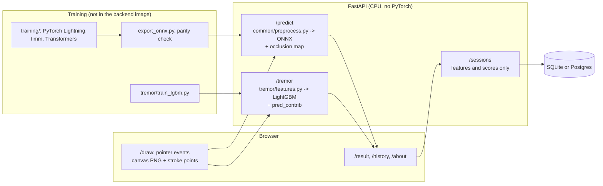

# Parkinson's Disease Screening from Spiral and Wave Drawings

A research and demonstration project: a deep learning model that reads a hand-drawn
spiral or wave, a signal-processing pipeline that measures tremor from how it was drawn,
and a web app that shows both.

> **Screening aid, not a diagnosis.** This tool looks for possible signs only. It is not
> clinically validated, it is not a medical device, and a result from it must never be used to
> decide anything about anyone's health. Talk to a clinician about any health concern.

## What is real and what is not

| Part | Status |
|---|---|
| Data pipeline, leakage-safe folds, shared preprocessing | Built and tested on the real HandPD and NewHandPD images (1264 images, 158 subjects). |
| Training, ablations, shortcut check, robustness, Grad-CAM, ONNX export | Code built and run in `--fast` mode only. Full multi-seed GPU runs are not done, so there are no real accuracy numbers yet (`TODO(run-on-gpu)`). |
| Image model in `backend/models/` | A small **development model**, labeled as such in its card. Its probabilities mean nothing. |
| Tremor features | Validated against simulated tremors with a known frequency and amplitude. |
| Tremor LightGBM model | Trained on **simulated** spirals only. It is a demonstration of the feature pipeline and of per-feature contributions, not a clinical model. |
| Backend, frontend, Docker, CI | Built and tested. Docker image builds and the CI workflow have not been run yet (see `HANDOFF.md`). |

## Architecture



`common/preprocess.py` is the single preprocessing implementation. Training reads image paths
through it and the backend reads canvas PNG bytes through it, and a test checks both produce the
identical tensor.

## Quick start

Python 3.11 and Node 22 are needed. Everything below assumes the repository root.

```bash
python -m venv .venv
.venv/Scripts/activate          # Windows; on Linux or macOS: source .venv/bin/activate
make setup                      # installs requirements-train.txt and backend/requirements.txt
make check                      # ruff, mypy, pytest
make backend                    # API on http://localhost:8000
make frontend                   # app on http://localhost:3000 (second terminal)
```

The frontend needs `NEXT_PUBLIC_API_URL=http://localhost:8000` and
`NEXT_PUBLIC_USE_MOCK_API=false` to talk to the backend. Without them it runs a clearly labeled
demo adapter. Copy `.env.example` to `.env` for the backend settings.

`make` is not installed on every system. Each target is a plain command you can copy out of the
`Makefile`.

### Make targets

| Target | What it does |
|---|---|
| `setup` | Install both dependency sets. |
| `check` | `ruff check .`, `mypy`, `pytest -q`. |
| `test` | `pytest -q` only. |
| `train-fast` | Smoke run of every backbone and the HOG + SVM baseline on a tiny real subset. |
| `export` | Export the champion to ONNX, run the parity check, write the model card and threshold. |
| `backend` | Run the FastAPI app with reload. |
| `frontend` | Run the Next.js dev server. |
| `up` | `docker compose up --build`: frontend, backend and Postgres. |

## Reproduce the results

Datasets are not committed. Follow `data/README.md` to download HandPD and NewHandPD, then:

```bash
python -m training.prepare_handpd --downloads-dir data/raw/_downloads --out-dir data/raw
python -m training.audit_data --config configs/data.yaml        # docs/DATASHEET.md, data/folds.csv
python -m tremor.validate --config configs/tremor.yaml          # tremor recovery figures
python -m tremor.train_lgbm --config configs/tremor_lgbm.yaml   # synthetic LightGBM and SHAP
python -m training.train --config configs/train_resnet50.yaml   # add --fast for a smoke run
python -m training.ablations --config configs/train_resnet50.yaml
python -m training.shortcut_check --config configs/train_resnet50.yaml
python -m training.robustness --config configs/train_resnet50.yaml
python -m training.explain --config configs/train_resnet50.yaml
python -m training.register --config configs/export.yaml
python -m training.export_onnx --config configs/export.yaml
```

Every script accepts `--config`, `--seed` and `--fast`. Without `--fast`, `train` runs 5 folds and
3 seeds per model, which needs a GPU (Colab or Kaggle); `HANDOFF.md` lists what to run and what to
copy back. `reports/REPORT_ASSETS.md` maps every table and figure the final report needs to the
command that generates it.

## Deployment

**Local, all services:** `docker compose up --build`, then open <http://localhost:3000>.

**Render:** `render.yaml` defines two web services and a managed Postgres. After the first deploy,
set `NEXT_PUBLIC_API_URL` on the frontend to the backend's public URL and `ALLOWED_ORIGINS` on the
backend to the frontend's public URL, then redeploy the frontend (the API URL is baked into the
browser bundle at build time). Free-tier limits: 512 MB RAM, services sleep after about 15 minutes
idle (open the demo a minute early), and the free database is not durable. The backend's measured
peak memory is about 300 MB, which is why it serves ONNX only and runs the occlusion map in chunks.

## Honest limitations

- **Small data.** 158 subjects. Differences between models are likely within noise; the project
  reports mean and standard deviation over grouped folds and a paired bootstrap, and says so when a
  difference is not significant.
- **Domain shift.** The model is trained on scanned paper drawings. A canvas drawing on a phone or
  a mouse trace looks different. Shared preprocessing and the skeleton re-render option reduce but do
  not remove this. It has not been tested on canvas drawings from real people.
- **Possible shortcuts.** A model can learn paper or scanner cues instead of the drawing. The
  shortcut check tests for this; its current result comes from a tiny `--fast` run and is not
  evidence either way.
- **The tremor model is simulated.** No labeled recording of strokes with diagnoses is available, so
  the LightGBM output shows that the features respond to a tremor, nothing more.
- **Mouse input is noisy,** and the UI says so. A stylus or touchscreen gives better data.
- **No clinical claims.** No part of this project has been validated against a clinician's
  assessment.

## Layout

```
common/      shared image preprocessing
training/    data, models, training, experiments, explain, export (offline, needs PyTorch)
tremor/      kinematic features, synthetic spirals, validation, LightGBM
backend/     FastAPI app, Dockerfile, models/ (ONNX, LightGBM, model cards)
frontend/    Next.js app, Dockerfile
tests/       pytest for common, tremor, training and backend
docs/        ASSUMPTIONS, DECISIONS, DATASHEET, MODEL_CARD, VIVA_QA, IDEAS
reports/     generated tables and Plotly figures (from real runs only)
```

## Credits

HandPD and NewHandPD are from the Signal Processing group at the Sao Paulo State University
(UNESP), Botucatu Medical School. Please cite the associated papers listed in `data/README.md`.
